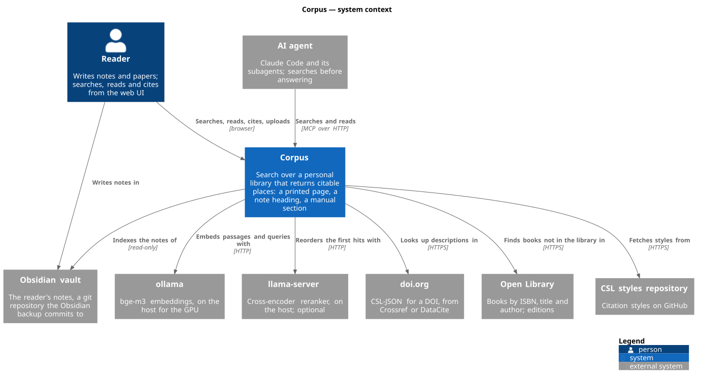
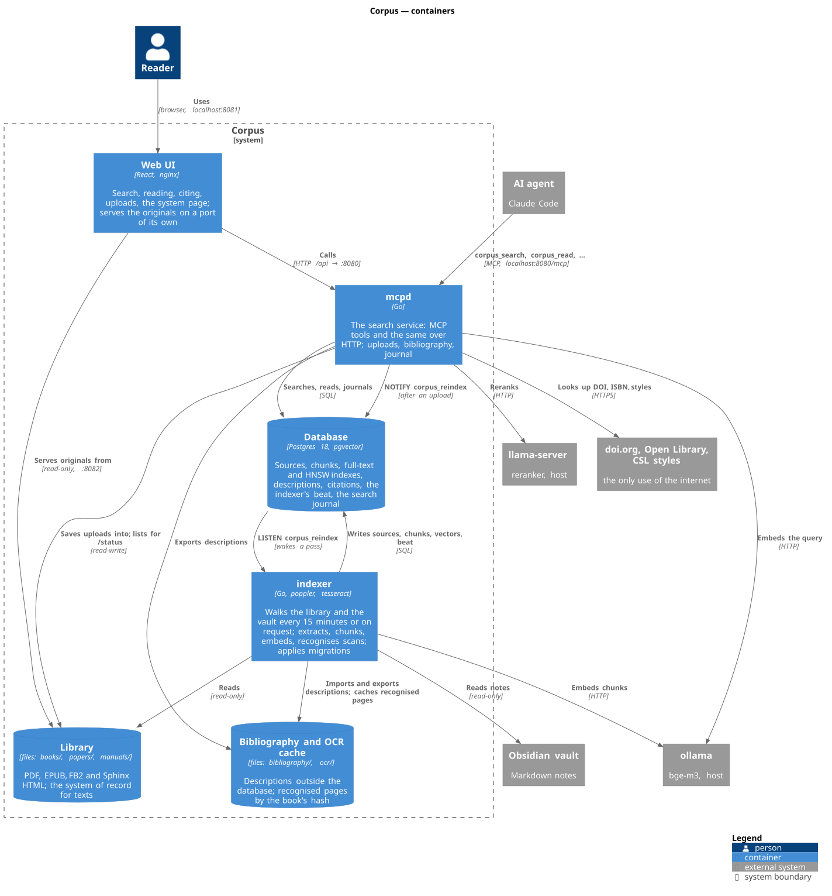
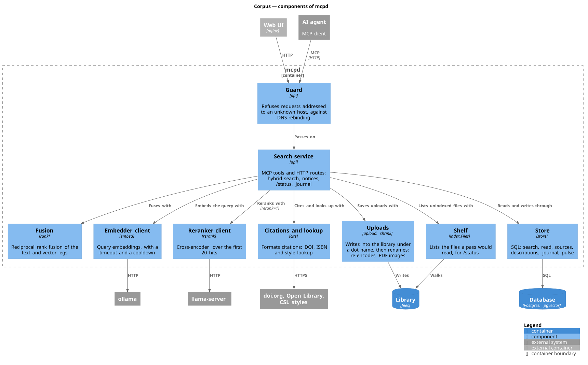
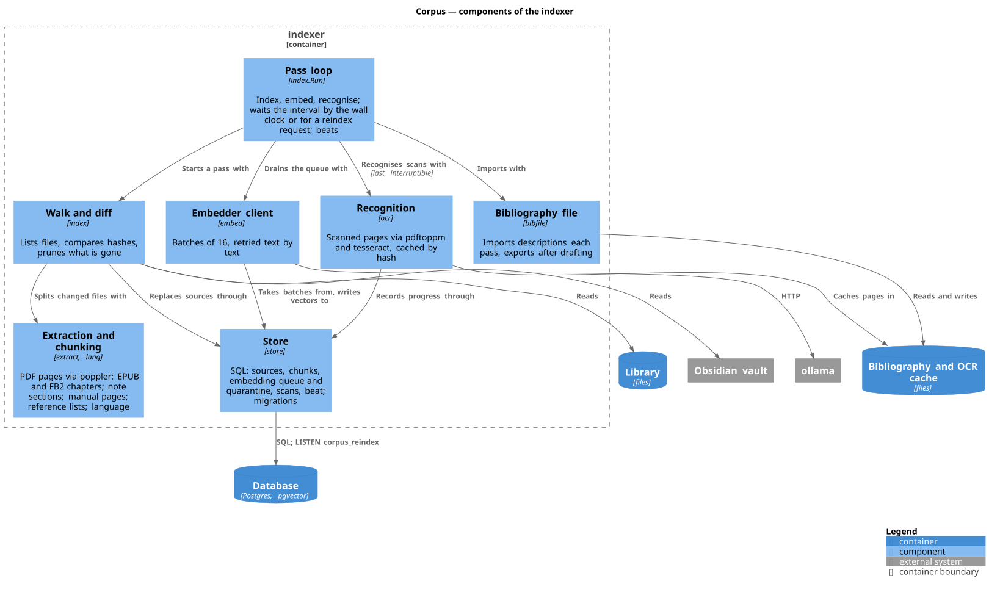

# C4 diagrams

The system drawn at three of the C4 model's four levels: its context, its
containers, and the components of the two containers that hold the code. The
fourth, code, is left to the code itself — "often more detail than is necessary
in your documentation" (*Communication Patterns*, PDF 27). Each diagram stays at
one level: a picture that splits the system into containers while also showing
its neighbours as peers mixes two levels, which the same page calls an
antipattern. A container is "something that needs to be running in order for
the overall system to work" (*Mastering API Architecture*, PDF 34), so the
library and the OCR cache, which are files, are containers next to the
database.

The sources are in [`c4/`](c4); `make diagrams` renders them with PlantUML,
using the C4 library its standard library ships, so no network is needed. A
change to the system that moves a box or an arrow changes the `.puml` and the
SVG in the same commit.

## Context

Two kinds of user: the reader in the browser, and agents over MCP, which search
far more often and are watched by no one — what the [search
journal](usage.md#the-search-journal) is for. The internet is reached only for
bibliographic lookups; search runs offline.

## Containers

The indexer and `mcpd` never call each other: Postgres is the one channel, a
`NOTIFY` included (see [architecture](architecture.md#design-notes)). ollama and
llama-server run on the host, outside Compose, because a containerised ollama
cannot reach the Mac's GPU.

## Components of mcpd

## Components of the indexer

