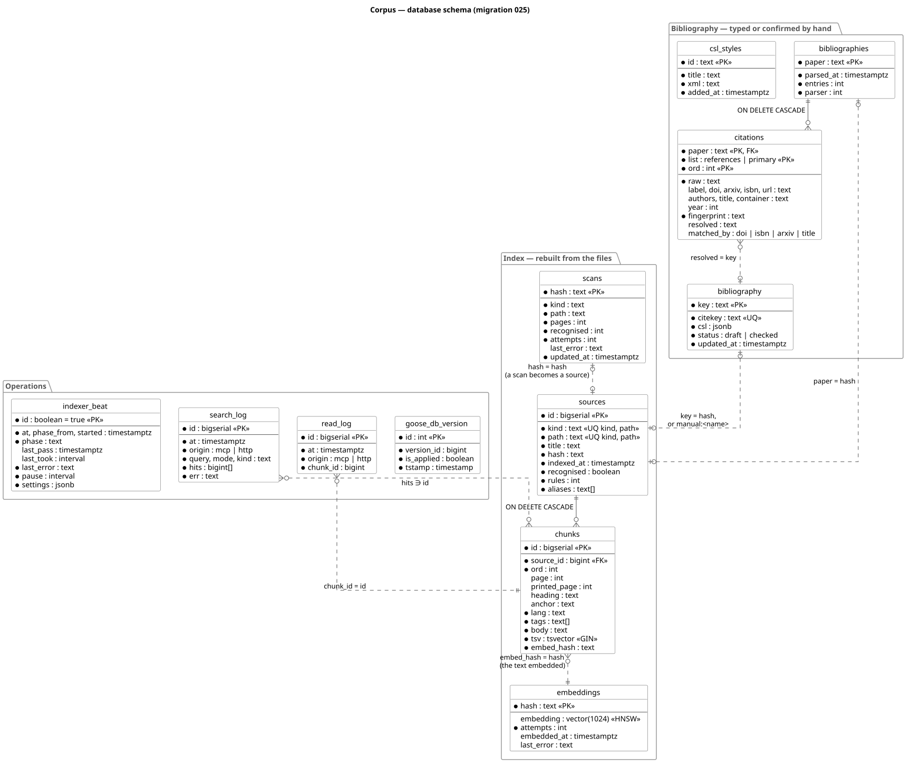

# Database schema

Drawn from the live database at migration 025, the source is
[`db/schema.puml`](db/schema.puml); `make diagrams` renders it with the C4
diagrams. Solid lines are foreign keys, dashed ones references the schema
leaves without a key on purpose.

**Two foreign keys, and both cascade inside what is rebuilt anyway**: a source's
chunks, a paper's citations. Every other link goes by content hash or by id,
for one of two reasons.

- **What cannot be rebuilt does not hang off what can.** A description is typed
  or confirmed by hand, so `bibliography` is keyed by the file's content hash
  (or `manual:<name>`), not by `sources.id`: a source pruned, renamed or
  uploaded again finds its description, where a foreign key would have taken
  it along. `bibliographies` and `scans` are keyed by the same hash for the
  same reason — reading a paper's references or recognising a scan is work
  that a new file name should not undo. The bibliography file under
  `bibliography/` is the system of record; the table is its copy.
- **A vector belongs to a text, not to a row.** `embeddings` is keyed by the
  hash of exactly what the embedder was handed, the chunk with a window of its
  neighbours. A changed file rewrites its chunks, and those whose window did
  not change find their vectors again.

`search_log` and `read_log` point at chunk ids without a key: a pass that
rewrites a source gives its chunks new ids, and the journal is a record of
what was returned then, not a reference that has to stay valid. Each write
drops the rows older than 180 days; see [is it used](usage.md#the-search-journal).

`indexer_beat` holds one row, the indexer's last word about itself, and
`goose_db_version` is the migration tool's. The indexer applies migrations on
start and `mcpd` refuses a schema behind its build.

A source is its kind and its path together. Books and publications each keep
an `uploads/` directory, so one file uploaded as both has the same relative
path under two roots; when the path alone was the key, the second overwrote
the first, and the next pass took the book for unchanged and never indexed it
again (migration 025).
